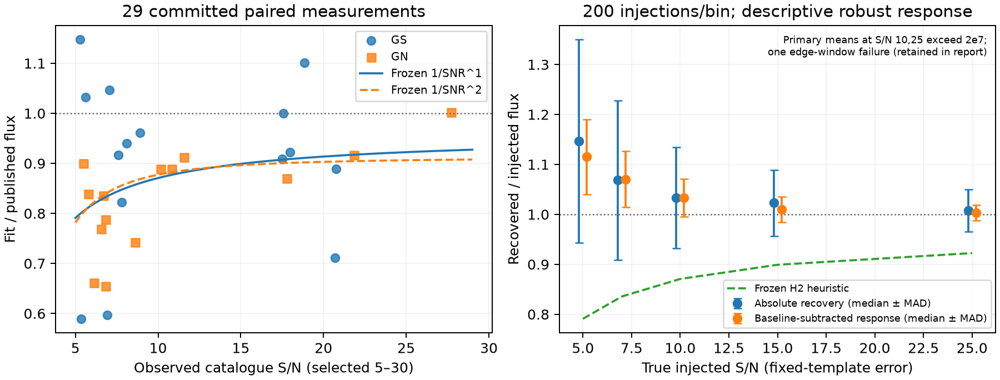

# Flux-deficit diagnosis: frozen paired-log reproduction and injection control

Arm A uses only committed JSON and compact spectra. It changes no fitter, imports no new science data, and downloads zero bytes. The final H1/H2 causal verdict also requires the independently selected comparison in arm C; a control on these spectra alone cannot establish catalogue selection bias.

## Reproduced pattern and frozen predictions

The 29 successful rows represent 29 different objects. Ordinary least squares uses per-row log(fit/published), with catalogue S/N = published_flux / published_error. All confidence intervals below resample objects 10,000 times with PCG64 seed 20261015. They describe this selected sample, rather than population coverage.

| Law | Intercept a (95% bootstrap CI) | Slope b (95% bootstrap CI) | Residual SD |
|---|---|---|---|
| a + b/SNR^1 | -0.042276 [-0.174080, 0.089234] | -0.961302 [-2.355619, 0.338291] | 0.166010 |
| a + b/SNR^2 | -0.092274 [-0.178788, -0.008112] | -3.859815 [-10.886108, 2.251973] | 0.167317 |

Median ratio 0.889185, object-bootstrap 95% CI [0.835998, 0.916616]. Splitting at the median catalogue S/N 8.099744 gives 0.835998 below/equal (15 rows) and 0.910561 above (14 rows). There are 23/29 negative log ratios; two-sided sign-test p = 0.0023157. Log-ratio SD 0.170030; unscaled MAD 0.078347.

The inverse-S/N intercept admits zero; the inverse-square intercept does not in this bootstrap. Both slope intervals admit zero. The field imbalance is associated with catalogue S/N, but these small overlapping samples cannot establish that it is entirely an S/N effect or exclude a field effect. Similar in-sample residual SD cannot distinguish the two laws.

Flux fits and catalogue measurements share photons only partly because they use different extractions. Empirical paired-log scatter is therefore the comparison scale; no quadrature denominator or assumed zero/full covariance is used here.

## Frozen operator and injection design

**Premise correction:** `marginal_fit` has signed linear line amplitudes at every node and no positivity truncation. The attached handover described positivity, which is false for the current operator. The unchanged 41 x 41 offset/width marginalization is tested; no operator fix is inferred from that incorrect premise.

Commit `e2bc0c1` froze the models and complete injection protocol before compact-spectrum window access. Commit `0584b24` added the secondary baseline-subtracted response before any marginal baseline or injection fits. Eligible windows are determined by wavelengths, finite positive errors and a frozen strong-line mask, without cuts on measured flux. There are 763 eligible windows from 25 objects. Here “line-free” means outside this declared mask; unknown lines, stellar absorption and structured backgrounds remain possible.

For each of true S/N 5, 7, 10, 15 and 25, 200 trials draw windows with replacement. A bin-integrated Gaussian has sigma one median pixel and centroid at the frozen offset-prior center, -0.25 pixel. Its known flux equals requested S/N times the fixed-template continuum-marginalized flux error. This is **true injected S/N**, distinct from noisy observed catalogue S/N. Applying the empirical catalogue-S/N curve to it is the handover’s specified heuristic H2 prediction, not an exact mapping between the two sampling schemes. There is also an estimand mismatch: exp(predicted log ratio) is a geometric response, while the frozen primary injection statistic is an arithmetic mean. Thus the numerical H2 comparison is heuristic for two separate reasons and cannot establish or rule out catalogue selection bias. The frozen primary is preserved; no criterion is rewritten after outcome access.

Each injection is added to the unmodified actual spectral background; no extra Gaussian noise is added. The primary response is F(background + line)/F_injected. Secondary F(background + line) - F(background), divided by F_injected, separates pre-existing background structure from nonlinear marginalization response. Backgrounds are shared, so uncertainty resamples background objects, never individual injections as independent observations.

## Descriptive subsets

The handover subset medians reproduce: GS 0.921866 (15), GN 0.854938 (14); [OIII]5007 0.888967 (18), Hβ 0.921866 (5), Hγ 0.878063 (6); g140m 0.870365 (9), g235m 0.904482 (16), g395m 0.958477 (4). Median fitted/published error ratio is 1.054149. These small, imbalanced overlapping subsets do not demonstrate exchangeability of fields, lines or gratings. `a_descriptive.json` preserves the numbers and compact-input SHA256 values.

## Per-row paired ratios

| Object | Field | Line | Grating/filter | Catalogue S/N | Fit/published | Log ratio |
|---|---|---|---|---|---|---|
| goods-s-mediumjwst_86986 | GS | O3_5007 | g235m_f170lp | 17.5097 | 0.90931 | -0.09507 |
| goods-s-mediumjwst_35715 | GS | O3_5007 | g235m_f170lp | 20.6995 | 0.71085 | -0.34129 |
| goods-s-mediumjwst_10004929 | GS | O3_5007 | g235m_f170lp | 8.8955 | 0.96130 | -0.03946 |
| goods-s-mediumjwst_41833 | GS | O3_5007 | g235m_f170lp | 8.0997 | 0.94014 | -0.06172 |
| goods-s-mediumjwst_204125 | GS | O3_5007 | g235m_f170lp | 5.3306 | 0.58941 | -0.52863 |
| goods-s-mediumjwst_51236 | GS | O3_5007 | g235m_f170lp | 6.9083 | 0.59666 | -0.51641 |
| goods-s-mediumhst_9569 | GS | HBaB_4861 | g235m_f170lp | 5.6300 | 1.03202 | 0.03152 |
| goods-s-mediumjwst_20046866 | GS | O3_5007 | g395m_f290lp | 20.7586 | 0.88919 | -0.11745 |
| goods-s-mediumjwst_187034 | GS | HBaG_4340 | g235m_f170lp | 7.0434 | 1.04651 | 0.04546 |
| goods-s-mediumhst_12402 | GS | O3_5007 | g235m_f170lp | 18.8518 | 1.10142 | 0.09660 |
| goods-s-mediumjwst_192368 | GS | HBaG_4340 | g140m_f070lp | 7.7891 | 0.82218 | -0.19580 |
| goods-s-mediumjwst_41457 | GS | HBaG_4340 | g235m_f170lp | 7.5907 | 0.91662 | -0.08707 |
| goods-s-mediumjwst_188720 | GS | HBaB_4861 | g140m_f070lp | 17.9744 | 0.92187 | -0.08136 |
| goods-s-mediumhst_15353 | GS | HBaG_4340 | g235m_f170lp | 5.2864 | 1.14805 | 0.13806 |
| goods-s-ultradeep_201127 | GS | HBaB_4861 | g395m_f290lp | 17.5875 | 1.00055 | 0.00055 |
| goods-n-mediumjwst_78501 | GN | HBaB_4861 | g140m_f070lp | 6.8296 | 0.65440 | -0.42403 |
| goods-n-mediumjwst_53501 | GN | HBaG_4340 | g235m_f170lp | 8.5949 | 0.74212 | -0.29825 |
| goods-n-mediumhst_33432 | GN | HBaG_4340 | g140m_f070lp | 5.7700 | 0.83951 | -0.17494 |
| goods-n-mediumjwst_58825 | GN | O3_5007 | g235m_f170lp | 6.5659 | 0.76908 | -0.26257 |
| goods-n-mediumjwst_28665 | GN | O3_5007 | g140m_f070lp | 11.5571 | 0.91181 | -0.09233 |
| goods-n-mediumjwst_70366 | GN | O3_5007 | g140m_f070lp | 17.7863 | 0.87037 | -0.13884 |
| goods-n-mediumhst_31873 | GN | HBaB_4861 | g235m_f170lp | 5.4683 | 0.89965 | -0.10575 |
| goods-n-mediumjwst_25511 | GN | O3_5007 | g235m_f170lp | 6.1319 | 0.66124 | -0.41364 |
| goods-n-mediumjwst_12474 | GN | O3_5007 | g235m_f170lp | 6.6845 | 0.83600 | -0.17913 |
| goods-n-mediumhst_24892 | GN | O3_5007 | g140m_f070lp | 10.1415 | 0.88894 | -0.11772 |
| goods-n-mediumjwst_18473 | GN | O3_5007 | g140m_f070lp | 6.8338 | 0.78833 | -0.23784 |
| goods-n-mediumjwst_5888 | GN | O3_5007 | g395m_f290lp | 21.8319 | 0.91640 | -0.08730 |
| goods-n-mediumjwst_14101 | GN | O3_5007 | g140m_f070lp | 10.8287 | 0.88899 | -0.11767 |
| goods-n-mediumjwst_8541 | GN | O3_5007 | g395m_f290lp | 27.7206 | 1.00174 | 0.00174 |

## Injection results and bounded verdict

**Verdict: neither frozen curve describes this control; H1 versus H2 remains unresolved.** The pooled S/N 5 and 7 primary mean is 1.181081, object-bootstrap 95% CI [1.092940, 1.327015]. It includes neither unity nor the much lower H2 heuristic. This is an upward low-S/N response, rather than the proposed low-S/N deficit. The control does not confirm catalogue selection bias, and the strong-line mask does not certify all backgrounds as line-free.

| True S/N | N | Mean absolute (95% object-bootstrap CI) | SD | Median | MAD | Mean increment | H2 heuristic |
|---|---|---|---|---|---|---|---|
| 5 | 200 | 1.27458 [1.11274, 1.54888] | 0.995224 | 1.146692 | 0.203874 | 1.13848 | 0.790937 |
| 7 | 200 | 1.08758 [1.04857, 1.12329] | 0.239023 | 1.068530 | 0.159766 | 1.07547 | 0.835600 |
| 10 | 200 | 2.32748e+07 [1.02074, 8.07218e+07] | 3.29155e+08 | 1.033157 | 0.101401 | 2.1433e+07 | 0.870745 |
| 15 | 200 | 1.01582 [1.00379, 1.02741] | 0.0978147 | 1.022838 | 0.065822 | 1.01369 | 0.899098 |
| 25 | 200 | 2.21697e+07 [0.959448, 7.47294e+07] | 3.13527e+08 | 1.007442 | 0.042079 | 2.1433e+07 | 0.922444 |

**Retained numerical failure:** one background window (GOODS-S object 188720, center 1.125000 µm) was drawn at S/N 10 and 25. It passes the frozen >=20-bin rule but its finite bins extend only 1.127000–1.139728 µm: the injected center is outside valid coverage. The weakly identified line tail and broad width marginalization return absolute ratios 4.654959e9 and 4.433945e9; the unmodified background fit itself is 3.201496e13 in flux units. Both trials are retained without clipping or replacement. Means/SD and bootstrap means for these bins are dominated by this failure. Counting finite bins was insufficient to guarantee central line coverage or numerical conditioning. No condition-number threshold, new cut or operator change was introduced after these outcomes. The control therefore supplies no numerical certification of arbitrary allowed windows.

The low-S/N secondary increment means are 1.138477 [1.119552, 1.157584] and 1.075466 [1.060426, 1.089198]; at S/N15 it is 1.013692 [1.005383, 1.022413]. These conditional responses are upward. The two pathological high-S/N increments also explode and remain in the secondary result. Small robust medians at high S/N are descriptive and do not rescue the frozen arithmetic-mean criterion. Different background draws in each bin also prevent treating the curve as a matched-window S/N experiment.

The right panel deliberately labels median ± unscaled MAD (descriptive spread, not confidence intervals), and annotates the explosive primary means. Complete individual trials, primary means, confidence intervals and background fits are preserved in `a_injections.json`. No control was discarded.

## Chronology, acceptance and limits

Primary freeze commit `e2bc0c1` at 04:58:23 UTC; secondary freeze `0584b24` at 04:59:06 UTC. First baseline/injection access began 2026-10-15T04:59:10.095499+00:00; completion 2026-10-15T05:01:45.506014+00:00. These are local-clock receipts, not externally attested timestamps. The frozen JSON SHA256 is `b5d76e006fded5b3e3773afaedc5ae47b6687e0af83ab1a5f22c20cffbd60427` and unchanged fitter SHA256 is `b51981b1095dd7e14d1a385f9408e2a16b4cb8ecd0d10a5039c8f28f8fba55db`. Actual science transfer: 0 bytes of the 0-byte cap.

Acceptance executed: `python -m data_pipeline.flux_deficit freeze` (before access); `OPENBLAS_NUM_THREADS=1 OMP_NUM_THREADS=1 python -m data_pipeline.flux_deficit inject` (1000 trials, 200 per bin); `python -m data_pipeline.flux_deficit plot`; `python -m pytest tests/test_flux_deficit.py tests/test_calibrated_population.py -q` (6 passed); `ruff check --select E,F,I data_pipeline/flux_deficit.py tests/test_flux_deficit.py` (passed). Shared environment `/workspace/work/venv` supplies the dependencies.

Not run by A: southern heldout access; any downloads; independent-line selection or new catalogue selection; alternative window/center/width injection designs; clean Gaussian-noise injection ensemble; conditioning-based exclusions or operator repair; empirical full covariance calibration; raw end-to-end known-answer calibration; MoM/G235H/SMACS analyses; full quality gate or cross-lineage audit. No state files or grades changed.

Dependency provenance limitation: the shared environment was being aligned to the research lock while the injection process was running. No process-local version dump was captured; NumPy may have been 2.5.4 rather than locked 2.5.3. These injections are not claimed as exact-lock execution. The frozen fitter bytes are unchanged, and the primary fit reproduction used system NumPy.
