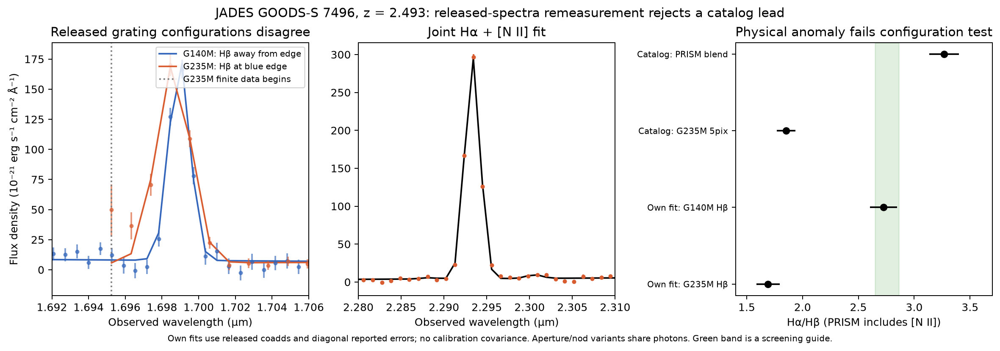

# Discovery-oriented pilots, 12 October 2026

The objective is a novel, noteworthy result that can be shared honestly, not
more platform features or a larger count of experiments. Target flexibility
is 5/5, ambition 4/5, platform development 1/5, autonomy 5/5, and sustained
investigation 4/5. This continuation used GPT-6.1 Sol high specialists, separate
numerical reviewers, and bounded experiments. **No new astrophysical discovery
has survived these pilots.** Negative results below are useful triage, not
substitutes for that objective.

## Verified incoming state

Both the GitHub connector and fresh checkout identified master as
`1191bae5911d4983206e225764f0ef7108690683`; the checkout was clean and no PR was
open. Python 3.12.14 and all 65 research-lock distributions matched exactly.
With one BLAS thread, 57 focused tests passed without skips or failures. The
release audit verified 46 canonical artifacts, 261 historical artifacts and
344 tracked JSON files. All scientific values in the 480-fit/six-heldout
compact replay reproduced exactly; only two runtime fields changed. The two
retained metadata replays also matched. These checks did not restore raw
exposures or rerun the Cloudy thermal solver.

## Portfolio decisions

| Track | Discriminating question | Decision |
|---|---|---|
| JADES DR4 Balmer ratios | Does a low ratio survive aperture and separate released grating checks? | Executed catalog screen and two targeted released-spectrum remeasurements. The strongest lead fails configuration consistency; the second lacks strong independent confirmation. |
| MoM finite-model observing forecast | Does modest relative ion-response freedom erase the proposed N III/C III contrast? | Executed and independently validated. Modest freedom has little effect; independently free ion amplitudes remove practical discrimination. Stop this bounded supporting track. |
| NEXUS spectral variability | Is an unexamined public epoch available to test a new mechanism prediction? | No independent post-study processed epoch was demonstrated at the documented endpoint. Stop, with a reopening condition. |

Public interest was assessed separately from evidence. Balmer anomalies and
LRD variability are already published topics; reproducing either is not a
novelty claim. Target-specific web-search silence is not proof of novelty.

## What the experiments actually establish

The JADES discovery sample contains 132 operational sky representatives from
135 selected observation rows. Eleven have catalog H-alpha/H-beta below the
declared 2.65 screening threshold, and seven remain below it in both extraction
apertures. These counts are selected-sample diagnostics, not population
fractions or independent detections. GOODS-N outcome measurements remain
unopened for a future frozen test. The 2.65 threshold is a screening choice,
not a universal atomic lower bound.

The strongest lead, GOODS-S 7496 at z=2.493465, looks stable across apertures,
but separate released grating configurations disagree on H-beta. A bin-integrated line fit
gives approximately 239 versus 386 in units of 1e-20 erg/s/cm2, while H-alpha is
about 652. The overlap-based ratio is about 2.73, compared with 1.69 using the
suspect grating alone. Independent continuum-subtracted integration gives
different conditional numerical estimates but the same discrepancy and an
overlap-based ratio around 2.86. H-beta lies near the first finite wavelength
of the suspect spectrum. This is evidence against a robust physical anomaly;
it does not identify the causal calibration, extraction or contamination error.
Neither method certifies the G140M value as unbiased or determines the intrinsic
decrement. Shared calibration and point-source slit-loss assumptions remain.
Different aperture/nod reductions share photons and are not independent
replications. No calibrated significance is inferred from diagonal errors.

The next inspected lead, GOODS-S 8656, has a low conditional ratio but weaker
support and an unstable, noisy overlap measurement. It is unresolved, not a
validated discovery. A line falling in a masked gap supplies no measurement.
The [independent JADES audit](RESEARCH3_JADES_INDEPENDENT_REVIEW.md) gives
selection details, independent integration, source identities and limitations.
The [author pilot report](JADES_BALMER_PILOT.md) records methods, prior literature,
the wider opportunity comparison and the zero-download compact replay command.



The retained MoM forecast is separately documented in
[the ion-gain report](MOM_CLOUDY_ION_GAIN.md). Allowing a hypothetical +/-50%
alternative relative N III/C III response raises the hardest-pair matched SNR
from 11.315 to 12.540. Independently free ion amplitudes raise it to about
13,546. This is a conditional finite-family design constraint, not new source
data, exposure-time prediction, or abundance evidence. An independent
quadrature/NNLS oracle checks all 10,800 comparisons.

[The NEXUS feasibility report](NEXUS_FEASIBILITY.md) records the primary
literature, exact public endpoint, acquisition scope and stopping decision.
It does not claim an exhaustive archive search or absence of later raw data.

## Inputs and reproduction

The JADES catalog and eight selected spectrum products total **101,067,840
body bytes**: 94,124,160 catalog bytes, 5,192,640 for 7496, and 1,751,040 for
8656. Metadata HTML transfers are additional and were not fully instrumented.
The catalog budget was explicitly raised from 50 MB to 150 MB before its
download, avoiding a complicated partial-file acquisition. Target follow-up
used a separate 100 MB ceiling. NEXUS's approximately 3.6 MB is separately
qualified in its report; it is not an exact combined session bandwidth ledger.

The committed `jades_balmer_*_download.json` receipts record URLs, sizes and
whole-product hashes. `*_inputs.npz` preserve released 1D arrays and
`*_windows.npz` preserve source-specific fit windows; these are compact coadd
replays, not raw-exposure reductions. The full catalog is intentionally not
duplicated in git. Restore its exact bytes and the selected products with:

```bash
python - <<'PY'
import hashlib, json, urllib.request
from pathlib import Path
from urllib.parse import urlsplit

destination = Path('/tmp/jades-research3-inputs')
destination.mkdir(exist_ok=True)
receipts = Path('research_output')
entries = [json.loads((receipts / 'jades_balmer_catalog_download.json').read_text())]
for target in ('7496', '8656'):
    entries += json.loads((receipts / f'jades_balmer_{target}_download.json').read_text())['files']
for entry in entries:
    path = destination / Path(urlsplit(entry['url']).path).name
    if path.exists():
        body = path.read_bytes()
    else:
        with urllib.request.urlopen(entry['url'], timeout=120) as response:
            body = response.read(entry['bytes'] + 1)
    assert len(body) == entry['bytes'], path
    assert hashlib.sha256(body).hexdigest() == entry['sha256'], path
    path.write_bytes(body)
print(destination)
PY

export OPENBLAS_NUM_THREADS=1 OMP_NUM_THREADS=1 MKL_NUM_THREADS=1 BLIS_NUM_THREADS=1
python -m tools.jwst.jades_balmer_pilot \
  --directory /tmp/jades-research3-inputs --output /tmp/jades-research3-replay
python -m discovery.research3_jades_review catalogue \
  --data-root /tmp/jades-research3-inputs \
  --reference-root data_sources/research3/audit/frozen_inputs \
  --output-root /tmp/jades-research3-review
python -m discovery.research3_jades_review spectrum --source-id 7496 \
  --data-root /tmp/jades-research3-inputs --output-root /tmp/jades-research3-review
python -m discovery.research3_jades_review spectrum --source-id 8656 \
  --data-root /tmp/jades-research3-inputs --output-root /tmp/jades-research3-review
```

Use the exact research lock. Independent numerical receipts are preserved in
`data_sources/research3/audit/` and `research_output/research3_gain_review.json`;
the incoming verification scope is pinned in `research_output/research3_baseline.json`.
The raw-input restoration recipe above is provided for a fresh checkout;
the present run acquired those bytes once and checked the recorded hashes.

The final local quality gate passes **732 tests with three explicit skips**
(735 collected, no failures/errors), plus lint, formatting and configured type
checks. The skips still require the separately provisioned imaging archive or
the pinned author Cue weights. They do not validate those missing inputs.
`research_output/research3_validation.json` pins the tested Python files and
compressed full gate log/JUnit evidence. Numerical and actual-coadd reviews
remain separately scoped; successful software tests are not discovery evidence.

## Next scientific decision

Do not promote these results as a cosmic discovery. The concrete useful result
is that aperture stability alone failed to validate this selected line-ratio
anomaly. Before opening GOODS-N, freeze quality criteria using the GOODS-S
lessons and catalog documentation, including spectral coverage, calibration
and overlap checks. Obtain independent review of that selection and a
multiple-testing-aware statistical plan. If no discriminating measurement is
available, pivot to a different physical question and dataset rather than
expanding fits or forcing a headline.

Preserve all previous RATE-v3 evidence standards and the scientific limits in
[the main report](FINAL_RESEARCH_REPORT.md). No paid service or external-person
contact was used.
