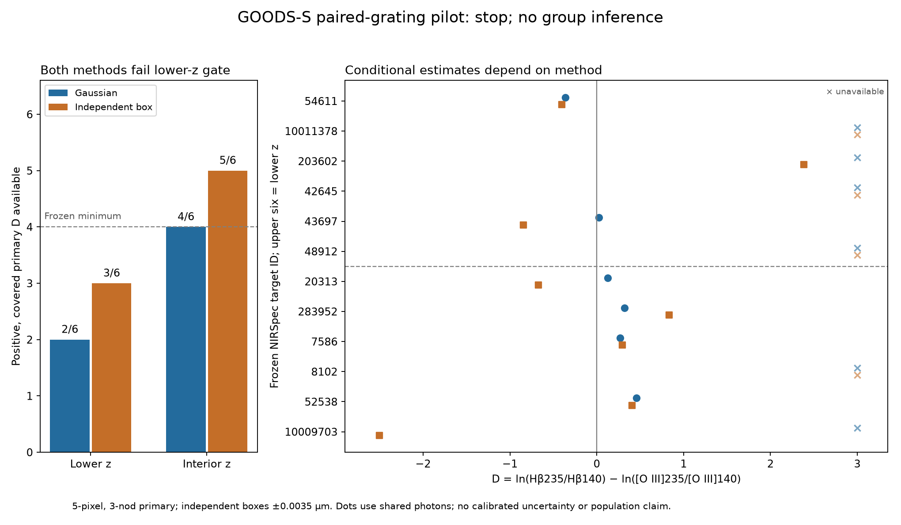

# Frozen GOODS-S paired-grating experiment

**Stop this population/edge-follow-up design and keep GOODS-N closed.** The
metadata-selected twelve-source experiment fails its frozen minimum of four
usable sources in each group. Gaussian fitting has two of six lower-redshift
and four of six interior-redshift endpoints. Independent box integration has
three and five. Neither establishes a group effect or a new physical anomaly.

The pre-acquisition manifest SHA256 is
`3c181df81355e35afd738f0b390981e4dae7b1e92b11d0cd5cda4688676e2872`.
Independent metadata replay exactly reproduced the twelve identities, ordering
and 71/83 eligible observation rows. The selection uses GOODS-S A/B redshifts,
paired exposure metadata and fixed redshift groups; it never uses line flux,
SNR or decrement. The previously inspected 7496 and 8656 were excluded. No
targets were replaced, windows tuned, or cuts relaxed after outcomes.

The endpoint is `D = log(Hb235/Hb140) - log(OIII235/OIII140)`, which cancels an
exactly gray grating scale. It requires four positive, covered, identifiable
line measurements. Missing and signed fit values remain in receipts; unavailable
endpoints are not zero or discarded from selected counts. The uncertainties
remain conditional on supplied diagonal errors; this pilot reports no p-value,
sigma, frequency, cause of calibration error or intrinsic Balmer decrement.

| Target | Gaussian D | Independent primary box D | Primary Gaussian failure or limit |
|---|---:|---:|---|
| 54611 | -0.362 | -0.402 | Available; Hb grating ordering opposite to 7496 |
| 10011378 | unavailable | unavailable | G140M Hb masked coverage |
| 203602 | unavailable | +2.386 | G140M Hb fit boundary/nonconvergence; box Hb near zero |
| 42645 | unavailable | unavailable | Negative G235M Hb; G235M OIII invalid fit |
| 43697 | +0.026 | -0.844 | Weak Hb; estimator-dependent sign |
| 48912 | unavailable | unavailable | G235M Hb outside finite coverage |
| 20313 | +0.125 | -0.674 | Estimator-dependent sign |
| 283952 | +0.322 | +0.832 | Same primary sign; substantial magnitude difference |
| 7586 | +0.270 | +0.292 | Primary agrees; 3-pixel box changes sign |
| 8102 | unavailable | unavailable | G140M Hb invalid fit; box also unavailable |
| 52538 | +0.460 | +0.405 | Primary agrees; some aperture/nod variants change sign |
| 10009703 | unavailable | -2.505 | G235M Hb invalid fit; box Hb near zero |

54611 is a defensible **measurement-discrepancy lead**: Gaussian Hb is
170.76 in G140M versus 110.23 in G235M, while OIII is 724.65 versus 671.93,
in `1e-20 erg/s/cm2`. Independent integration gives D=-0.402, and all twelve
box/aperture/nod sensitivity values remain negative. Its G235M predicted Hb
is 0.01888 micron from the first finite pixel, farther than training7496's
0.00351 micron. This does not support a simple universal positive edge bias,
prove an edge cause, determine the unbiased grating, or establish novelty.
The independent and Gaussian estimates use the same released photons.

The extra box-positive endpoints for 203602/10009703 contain near-zero Hb:
about 2.97 +/-46.18 or 2.95 +/-20.66, respectively, under conditional diagonal
errors. Positivity alone supplies no strong evidence. Aperture/nod checks and
alternative box widths share data and cannot be counted as independent tests.

Actual acquisition used **24 x1d products, 17,475,840 body bytes**. The original
wire ledger is `research4_jades_acquisition_run.json`; later zero-download
remeasurements record zero new bytes separately. Every product has a whole-file
SHA256 and identity/unit/coordinate checks; cached or reacquired pinned inputs
must match the acquisition hashes. The final numerical replay took 7.63
seconds of fitting. Twenty-four compact NPZ files preserve complete released
3/5-pixel wavelength, flux/error and NOD2 arrays, with identity and provenance
provided by the exact manifest and acquisition receipts. They are released
coadd data, not detector exposures or independent reductions.

The independent compact replay additionally reproduces all 576 integration
measurements exactly from the 24 archived NPZ files, with pinned archive hashes
and byte counts: `research_output/research4_review_replay.json`.

The executable contract and conditions for an unopened GOODS-N test are in
`RESEARCH4_JADES_PROTOCOL_DRAFT.md`. The actual Gaussian results are
`research_output/research4_jades_pilot.json`; independent direct summation is
`research_output/research4_review_integration.json`. The independent reviewer
imports no Gaussian-fit code. Six focused regressions cover missing-line
coverage, gray-scale cancellation with signed flux retention, malformed grid
rejection, wrong-configuration identity and cached/reacquired-product
substitution. Existing hydrogen physics,
temperature/density null envelopes, calibration and selection-aware
multiplicity remain unresolved; no physical holdout opening is justified.

The source54611 discrepancy could motivate a tightly scoped exposure-level or
independently calibrated check. It does not justify enlarging this failed
group design. The next discovery round should move to a fresh discriminating
question unless such genuinely independent data are demonstrated.
